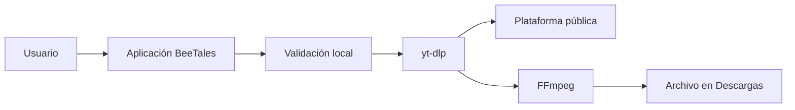

<p align="center">
  
</p>

<h1 align="center">BeeTales Video Downloader</h1>

<p align="center">
  Aplicación local, gratuita y sin publicidad para guardar contenido público autorizado como video MP4 o audio MP3.
</p>

<p align="center">
  <a href="https://github.com/Sorairei/BeeTales-Video-Downloader/releases"><strong>Descargar la versión más reciente</strong></a>
  ·
  <a href="https://github.com/Sorairei/BeeTales-Video-Downloader/issues">Reportar un problema</a>
  ·
  <a href="https://github.com/sponsors/Sorairei">Patrocinar el proyecto</a>
</p>

<p align="center">
  
  
  
  <a href="https://github.com/sponsors/Sorairei"></a>
</p>

## Descripción

BeeTales Video Downloader procesa todo en la computadora del usuario. No utiliza cuentas de BeeTales, publicidad, telemetría, almacenamiento en la nube ni un servidor central de descargas.

La aplicación acepta enlaces públicos de YouTube, TikTok, Instagram y X, consulta sus formatos disponibles y permite crear:

- Video MP4 con video y audio unidos mediante FFmpeg.
- Audio MP3 a 128, 192, 256 o 320 kbps.
- Descargas individuales con progreso, velocidad, tiempo restante y cancelación.
- Una cola local que no conserva historial de enlaces después de cerrar la aplicación.

Spotify, playlists, contenido privado, cuentas, cookies y DRM están fuera del alcance.

## Privacidad y funcionamiento



- Las solicitudes salen directamente desde la computadora del usuario.
- Los archivos nunca pasan por servidores operados por BeeTales.
- Solo se guarda la carpeta de destino y la preferencia de apariencia.
- No se guarda un historial de URLs.
- No se recopilan métricas, identificadores ni datos personales.

Consulta [PRIVACY.md](PRIVACY.md) y [USAGE_POLICY.md](USAGE_POLICY.md).

## Ejecutable de Windows

1. Descarga `BeeTales-Video-Downloader-Windows-x64.zip` desde [GitHub Releases](https://github.com/Sorairei/BeeTales-Video-Downloader/releases).
2. Extrae el archivo ZIP.
3. Ejecuta `BeeTales Video Downloader.exe`.
4. Pega un enlace público, selecciona MP4 o MP3 y elige la carpeta de destino.

El ejecutable incluye FFmpeg, FFprobe y Deno. No requiere Node.js, Python, Docker ni privilegios de administrador. La compilación inicial no está firmada digitalmente, por lo que Windows SmartScreen puede mostrar una advertencia.

## Ejecutar desde el código

Se requiere Python 3.12 o posterior con Tcl/Tk:

```powershell
py -3.12 -m venv .venv
.\.venv\Scripts\Activate.ps1
python -m pip install -r requirements.txt
python app.py
```

Para descargar o convertir desde el código fuente también deben estar disponibles `ffmpeg`, `ffprobe` y Deno en `PATH`, o dentro de `vendor/`. En Windows puedes descargarlos desde sus releases oficiales y verificar sus hashes automáticamente con:

```powershell
.\download_runtimes.ps1
```

## Arquitectura

| Ruta | Responsabilidad |
| --- | --- |
| `app.py` | Ventana CustomTkinter, cola, interacción y trabajadores en segundo plano |
| `downloader.py` | Validación, detección de herramientas e integración aislada con yt-dlp |
| `settings.py` | Preferencias locales atómicas sin historial |
| `theme.py` | Colores y tipografía BeeTales |
| `release_smoke.py` | Validación integral de recursos, dependencias y configuración |
| `test_downloader.py` | Pruebas de URLs, formatos y privacidad de preferencias |
| `assets/` | Logo, mascota, iconos y recursos visuales |
| `download_runtimes.ps1` | Descarga local y verificación SHA-256 de FFmpeg y Deno |
| `build_release.ps1` | Pruebas, compilación y validación local del ejecutable |
| `.github/workflows/` | CI y creación automática de GitHub Releases |
| `legacy-web/` | Prototipo web conservado únicamente como referencia histórica |

La interfaz nunca construye comandos de shell ni manipula argumentos multimedia. Toda esa lógica vive en `downloader.py` y usa la API de Python de yt-dlp.

## Pruebas

```powershell
python -m unittest -v test_downloader.py
python -m py_compile app.py downloader.py settings.py release_smoke.py theme.py
```

Las pruebas no realizan descargas reales ni contactan las plataformas. La validación de una entrega comprueba además que FFmpeg, FFprobe, Deno, yt-dlp y todos los recursos estén incluidos.

## Compilar para Windows

Prepara las herramientas oficiales, crea `.venv-build`, instala las dependencias y ejecuta:

```powershell
.\download_runtimes.ps1
py -3.12 -m venv .venv-build
.\.venv-build\Scripts\python.exe -m pip install -r requirements.txt
.\build_release.ps1
```

`build_release.ps1` ejecuta localmente las pruebas, valida Tcl/Tk y las herramientas multimedia, compila el ejecutable, realiza un smoke test y genera `dist/BeeTales-Video-Downloader-Windows-x64.zip` con su hash SHA-256. Las licencias se describen en [THIRD_PARTY_NOTICES.md](THIRD_PARTY_NOTICES.md).

## Uso responsable

Que un enlace sea público no significa que su contenido sea de libre distribución. Utiliza BeeTales solamente con contenido propio, de dominio público, con licencia compatible o cuando tengas autorización del titular.

La aplicación no evade autenticación, contenido privado ni DRM y no elimina marcas de agua mediante procesamiento. BeeTales no está afiliado con las plataformas compatibles.

## Patrocinar

BeeTales es gratuito, libre y sin publicidad. El patrocinio mediante [GitHub Sponsors](https://github.com/sponsors/Sorairei) es voluntario, no desbloquea funciones y no concede acceso preferente.

## Licencia

El código propio de BeeTales se distribuye bajo la [licencia MIT](LICENSE). Los componentes independientes conservan sus propias licencias.
