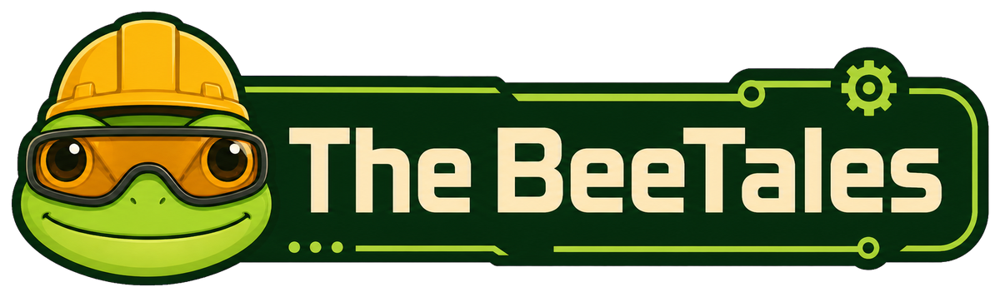
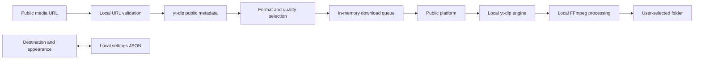

<p align="center">
  
</p>

<h1 align="center">BeeTales Video Downloader</h1>

<p align="center">
  A free, open-source desktop application for saving authorized public media as MP4 video or MP3 audio.
</p>

<p align="center">
  <a href="https://github.com/Sorairei/BeeTales-Video-Downloader/releases"><strong>Download the latest release</strong></a>
  ·
  <a href="https://github.com/Sorairei/BeeTales-Video-Downloader/issues">Report an issue</a>
  ·
  <a href="https://github.com/sponsors/Sorairei">Sponsor the project</a>
</p>

<p align="center">
  <a href="LICENSE"></a>
  
  
  
  <a href="https://github.com/sponsors/Sorairei"></a>
</p>

<p align="center">
  
</p>

## Overview

BeeTales Video Downloader is a local Windows application for downloading authorized public media from YouTube, TikTok, Instagram, and X. It analyzes the formats exposed by each public post and creates an MP4 video with audio or an MP3 audio file.

Processing runs on the user's computer through yt-dlp, FFmpeg, FFprobe, and Deno. BeeTales does not operate a download server, require an account, store URLs, display advertising, collect analytics, or upload completed files.

## Contents

- [Highlights](#highlights)
- [Supported sources and outputs](#supported-sources-and-outputs)
- [How it works](#how-it-works)
- [Privacy and security](#privacy-and-security)
- [Architecture](#architecture)
- [Download behavior](#download-behavior)
- [Repository structure](#repository-structure)
- [Windows application](#windows-application)
- [Local development](#local-development)
- [Local runtime setup](#local-runtime-setup)
- [Quality and validation](#quality-and-validation)
- [Limitations](#limitations)
- [Troubleshooting](#troubleshooting)
- [Responsible use](#responsible-use)
- [Contributing](#contributing)
- [Sponsorship](#sponsorship)
- [License](#license)

## Highlights

| Area | Capabilities |
| --- | --- |
| Public sources | Individual YouTube videos and Shorts, TikTok videos, Instagram posts and Reels, and X video posts |
| Video | MP4 output with video and audio merged locally through FFmpeg |
| Audio | MP3 output at 128, 192, 256, or 320 kbps |
| Quality | Real source heights are detected, including non-standard vertical resolutions |
| Compatibility | H.264 video and AAC audio are preferred, with automatic format fallbacks |
| Queue | Sequential downloads with per-item progress, speed, remaining time, and cancellation |
| Reliability | Active duplicates are rejected and application shutdown waits for local operations |
| Privacy | Destination and appearance preferences are local; URLs and download history are not stored |
| Interface | Branded BeeTales desktop experience with light, dark, and system appearance modes |
| Funding | Optional GitHub Sponsors support without advertisements, premium features, or preferential access |

## Supported sources and outputs

| Source | Accepted public content | Not supported |
| --- | --- | --- |
| YouTube | Individual videos, Shorts, live-video pages, and share links | Playlists, channels, accounts, private media, and DRM |
| TikTok | Individual video pages and official short links | Profiles, private media, authenticated sessions, and artificial watermark removal |
| Instagram | Individual posts, Reels, and legacy TV video pages | Profiles, stories requiring authentication, private media, and cookies |
| X | Individual video posts, public broadcasts, and compatible Twitter links | Profiles, private posts, authenticated sessions, and posts without public video |

| Output | Main controls | Processing |
| --- | --- | --- |
| Video MP4 | Detected source resolution | Video and audio selection, local merge, MP4 remux, and metadata |
| Audio MP3 | 128, 192, 256, or 320 kbps | Best public audio selection, local MP3 conversion, and metadata |

Spotify, bulk downloads, playlists, private content, accounts, cookies, payment bypasses, DRM bypasses, and artificial watermark removal are intentionally outside the project scope.

## How it works

1. The user pastes a supported public-media URL.
2. The application validates the HTTPS host and individual-content route locally.
3. yt-dlp reads public metadata and reports the source formats without adding a playlist.
4. The user selects MP4 or MP3, chooses a quality, confirms authorization, and selects a destination.
5. The request enters a sequential in-memory queue that rejects active duplicates.
6. yt-dlp downloads directly from the public platform to the selected local folder.
7. FFmpeg merges or converts the media and adds metadata locally.
8. The completed item can open its destination folder from the queue.

Cancelling signals the active job through yt-dlp progress and post-processing hooks. Closing the application asks for confirmation when operations are active, cancels the queue, and waits for local workers before exiting.

## Privacy and security

| Concern | Behavior |
| --- | --- |
| Source URLs | Used in memory for the current session and never added to settings or history |
| Downloaded media | Written directly to the user-selected local directory |
| Preferences | Only destination and appearance are stored in a local JSON file |
| Accounts and authentication | Not used |
| Cookies and analytics | Not included |
| BeeTales backend or database | Not required and not operated |
| URL validation | HTTPS-only allowlist with individual-content routes, no credentials, and no custom ports |
| Processing tools | Official FFmpeg, FFprobe, and Deno binaries are bundled in the Windows package |
| Shell execution | Media requests use the yt-dlp Python API; user URLs are never inserted into shell commands |

Requests leave the computer only to contact the selected public platform. Files never pass through infrastructure operated by BeeTales. See [PRIVACY.md](PRIVACY.md), [SECURITY.md](SECURITY.md), and [USAGE_POLICY.md](USAGE_POLICY.md).

## Architecture



### Design boundaries

- **Interface layer:** `app.py` owns CustomTkinter widgets, user interaction, progress cards, and safe application shutdown.
- **Queue layer:** `queue_manager.py` owns deterministic job states, active-request identities, duplicate protection, and coordinated cancellation.
- **Media layer:** `downloader.py` owns URL validation, tool detection, yt-dlp options, metadata normalization, FFmpeg selection, and safe errors.
- **Preference layer:** `settings.py` stores only the destination and appearance using an atomic local JSON replacement.
- **Theme layer:** `theme.py` contains the BeeTales colors and typography used by the desktop interface.
- **Validation layer:** `test_downloader.py`, `release_smoke.py`, and `qa_visual.py` cover deterministic behavior, packaged tools, multimedia output, and the compiled window.
- **Runtime layer:** `vendor/` contains the verified FFmpeg, FFprobe, and Deno executables bundled into the local Windows application.

## Download behavior

- Only one queue item is processed at a time to keep CPU, network, and disk usage predictable.
- The same URL, output, destination, and quality cannot be queued twice while active.
- Completed, cancelled, and failed jobs release their active identity and may be requested again.
- Existing outputs are not intentionally overwritten.
- Partial downloads use yt-dlp's resumable behavior when supported by the platform.
- Downloads are limited to two hours and 2 GB per item.
- Video selection prefers H.264 and AAC for broad MP4 compatibility before trying fallback formats.
- Real source heights between 144p and 4320p are preserved in the quality selector.
- Private, removed, regional, DRM-protected, rate-limited, non-video, and network failures receive safe user-facing messages.
- Queue contents exist only for the active application session and are never written to history.

## Repository structure

| Path | Responsibility |
| --- | --- |
| `app.py` | CustomTkinter window, interaction, background workers, and controlled shutdown |
| `downloader.py` | URL validation, tool detection, yt-dlp integration, formats, progress, and safe errors |
| `queue_manager.py` | Queue states, duplicate detection, cancellation, and active job identities |
| `settings.py` | Atomic local preferences without URL or download history |
| `theme.py` | BeeTales desktop colors and typography |
| `assets/` | Logo, mascot, application icons, avatar, and social-video artwork |
| `vendor/` | Bundled FFmpeg, FFprobe, and Deno Windows runtimes |
| `test_downloader.py` | Unit tests for URLs, formats, privacy, errors, settings, and queue behavior |
| `release_smoke.py` | Local release validation for assets, dependencies, runtimes, MP4, and MP3 |
| `qa_visual.py` | Controlled local screenshot and process-cleanup validation for the compiled window |
| `download_runtimes.ps1` | Official runtime download and SHA-256 verification |
| `build_release.ps1` | Local tests, compilation, executable smoke test, ZIP packaging, and SHA-256 output |
| `legacy-web/` | Historical GitHub Pages and Node.js API prototype retained for reference |
| `PRIVACY.md` | Local data and privacy guarantees |
| `SECURITY.md` | Security boundaries and vulnerability reporting |
| `USAGE_POLICY.md` | Authorized-use requirements and prohibited use cases |
| `THIRD_PARTY_NOTICES.md` | Third-party licenses and runtime notices |

## Windows application

1. Download `BeeTales-Video-Downloader-Windows-x64.zip` from [GitHub Releases](https://github.com/Sorairei/BeeTales-Video-Downloader/releases).
2. Extract the complete ZIP to a local folder.
3. Run `BeeTales Video Downloader.exe`.
4. Paste an authorized public URL, select MP4 or MP3, and choose the destination.

The package includes FFmpeg, FFprobe, and Deno. End users do not need Node.js, Python, Docker, administrator privileges, or a BeeTales account. Early releases are not digitally signed, so Windows SmartScreen may display a warning.

## Local development

Python 3.12 or later with Tcl/Tk is required:

```powershell
git clone https://github.com/Sorairei/BeeTales-Video-Downloader.git
cd BeeTales-Video-Downloader
py -3.12 -m venv .venv
.\.venv\Scripts\Activate.ps1
python -m pip install -r requirements.txt
python app.py
```

Run all validation from the repository on the local computer. The development workflow does not require a public processing server.

## Local runtime setup

Source downloads and conversions require `ffmpeg`, `ffprobe`, and Deno in `PATH` or in the repository's `vendor/` directory. Download official Windows assets and verify their hashes locally with:

```powershell
.\download_runtimes.ps1
```

Prepare the isolated build environment:

```powershell
py -3.12 -m venv .venv-build
.\.venv-build\Scripts\python.exe -m pip install -r requirements.txt
```

## Quality and validation

All project tests and release checks can be executed locally:

```powershell
.\.venv-build\Scripts\python.exe -m unittest -v test_downloader.py
.\.venv-build\Scripts\python.exe -m py_compile app.py downloader.py queue_manager.py settings.py release_smoke.py theme.py
.\.venv-build\Scripts\python.exe qa_visual.py
.\build_release.ps1
```

| Check | Purpose |
| --- | --- |
| Unit tests | Validate public URL shapes, real qualities, output options, safe errors, preferences, queue states, duplicates, and cancellation |
| Python compilation | Confirm every application module parses successfully |
| Source smoke test | Verify assets, dependencies, runtime identities, settings, and multimedia options |
| Synthetic MP4 and MP3 test | Use bundled FFmpeg and FFprobe without downloading third-party content |
| Compiled smoke test | Run the packaged executable in hidden validation mode |
| Visual QA | Launch the local executable, capture the window, and confirm child processes are cleaned up |
| Release package | Produce the Windows executable and ZIP together with the archive SHA-256 |

Unit tests do not contact supported platforms or perform real downloads. Public-platform metadata checks, when intentionally performed, analyze individual test links without saving their media.

## Limitations

- Platform compatibility depends on public page behavior and the bundled yt-dlp version.
- Some public posts still require authentication, cookies, regional access, or age verification and are therefore unsupported.
- Download speed depends on the platform, connection, selected quality, and local disk performance.
- Video and audio conversion can be CPU-intensive on older computers.
- Source formats may not offer every common resolution or codec combination.
- Cancellation depends on the next yt-dlp or FFmpeg progress callback and may not be instantaneous during a network timeout.
- The application currently targets 64-bit Windows 10 and Windows 11.
- The executable is not digitally signed.
- There is no cloud history, account synchronization, remote queue, or centralized processing service.

## Troubleshooting

| Symptom | Recommended action |
| --- | --- |
| Windows displays a SmartScreen warning | Confirm the ZIP came from `github.com/Sorairei`, verify its published SHA-256, and choose to run it only if you trust the release |
| FFmpeg or FFprobe is reported missing | Extract the complete official ZIP again instead of copying only the executable |
| A supported URL cannot be analyzed | Confirm it is an individual public post and update to the latest BeeTales release |
| The platform asks for a login | BeeTales does not use accounts or cookies; that content cannot be processed |
| The platform temporarily rejects requests | Wait several minutes and retry without rapidly repeating the analysis |
| A download has no requested resolution | Choose one of the real source heights reported by the application |
| MP4 processing is slow | Select a lower source quality and keep sufficient free disk space available |
| Cancellation takes several seconds | Allow the current network or FFmpeg operation to reach its next progress checkpoint |
| The application does not close immediately | Confirm cancellation and allow the controlled shutdown to finish active local operations |

## Responsible use

A public URL does not mean its media is free to copy or redistribute. Use BeeTales only for your own content, public-domain material, compatible licensed media, or content for which you have explicit authorization.

The application does not bypass authentication, private access, payments, territorial restrictions, or DRM. It does not artificially remove watermarks. BeeTales is not affiliated with YouTube, TikTok, Instagram, X, or their owners.

## Contributing

Bug reports, platform compatibility findings, accessibility improvements, tests, and focused feature proposals are welcome through [GitHub Issues](https://github.com/Sorairei/BeeTales-Video-Downloader/issues).

Contributions should preserve the local desktop architecture, privacy guarantees, English documentation, BeeTales visual identity, authorized-use boundaries, and advertisement-free open-source model. Read [CONTRIBUTING.md](CONTRIBUTING.md) before submitting changes.

## Sponsorship

BeeTales Video Downloader is free, open source, and has no advertisements. If it saves you time, you can support continued maintenance through [GitHub Sponsors](https://github.com/sponsors/Sorairei). Sponsorship does not unlock features or grant preferential access.

## License

Released under the [MIT License](LICENSE). Copyright © 2026 [Sorairei](https://github.com/Sorairei).

Third-party components retain their respective licenses. See [THIRD_PARTY_NOTICES.md](THIRD_PARTY_NOTICES.md).

---

<p align="center">
  Built with care by <a href="https://github.com/Sorairei">Sorairei</a> and the BeeTales community.
</p>
